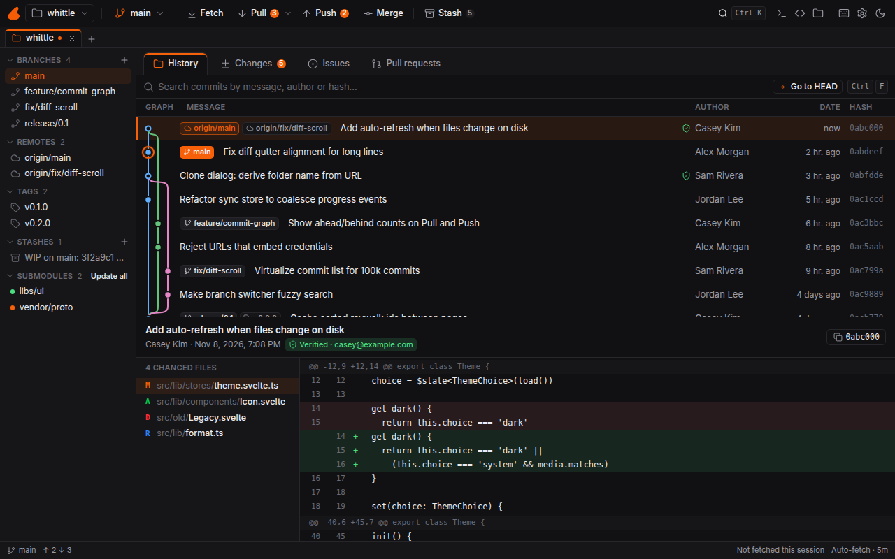
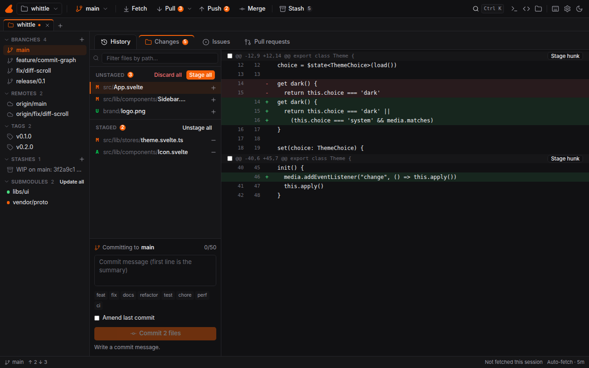
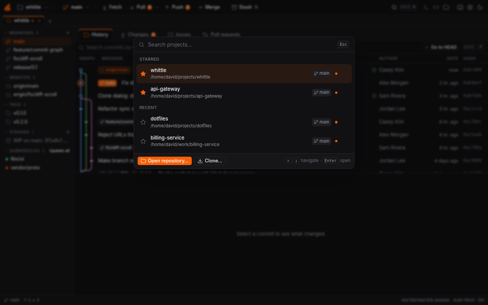

<p align="center">
  
</p>

<h1 align="center">Whittle</h1>

<p align="center">
  A fast, clean Git client for Linux.<br />
  <sub>Rust + Tauri 2 · Svelte 5 · built Ubuntu-first</sub>
</p>

<p align="center">
  
</p>

<p align="center"><sub>Screenshots use sample data.</sub></p>

## Why

Fork's workflow is hard to beat, but it only exists on macOS and Windows. Whittle brings that kind of workflow to Linux: a readable history graph, staging down to individual lines, and the everyday Git operations one click or one shortcut away. It does not copy Fork's look, name or assets.

## Features

**History**
- Commit graph with stable, high-contrast lanes, drawn on a canvas next to a virtualized list built for repositories with 100k+ commits.
- Search by message, author or hash. Blame, file history and signing indicators (GPG and SSH).

**Changes**
- Stage and unstage whole files, hunks or single lines. Filter files by path and act on the filtered set.
- Commit messages with a length counter and conventional-commit helpers. Amend support. Drafts survive switching projects during the session.

**Branches and integration**
- Create, switch, delete, merge and rebase, including interactive rebase (reorder, squash, edit, drop).
- Cherry-pick, revert, reset (soft, mixed, hard) and stash. Tags and submodules.
- Built-in conflict editor: side by side, pick or combine, edit the result, preview it, then save and stage with `Ctrl+S`.

**GitHub**
- Issues: list, filter, read the thread, comment, close or reopen.
- Pull requests: conversation, files changed with inline threads, submit reviews, check out locally.
- Sign in through the system keyring or the GitHub CLI. Tokens are never written to files.

**Day to day**
- Project switcher (`Ctrl+P`) with starred and recent projects, plus tabs for several repositories.
- Quick actions palette (`Ctrl+K`), Open in terminal or editor, light and dark themes.
- Background auto-fetch that backs off on errors and stays out of the way of running Git operations. Live refresh when files change on disk.

<table>
  <tr>
    <td width="50%"></td>
    <td width="50%"></td>
  </tr>
</table>

## Shortcuts

| Shortcut | Action |
| :--- | :--- |
| `Ctrl+K` | Quick actions |
| `Ctrl+P` | Switch project |
| `Ctrl+B` | Switch or create branch |
| `Ctrl+T` / `Ctrl+W` | New tab / close tab |
| `Ctrl+1` to `Ctrl+4` | History, Changes, Issues, Pull requests |
| `Ctrl+F` | Search commits |
| `Ctrl+Enter` | Commit |
| `?` | Show all shortcuts |

## How it works

Reads and writes are split on purpose.

- **Reads** (log, status, diffs, refs, blame) go through [libgit2](https://libgit2.org/) via `git2`. They are fast and need no process spawning.
- **Writes** (commit, push, pull, fetch, merge, rebase, stash) run the real `git` CLI from Rust. Your SSH agent, credential helpers, hooks, GPG signing and `.gitconfig` therefore behave exactly as in the terminal.

Long operations run asynchronously and stream progress to the UI, so it never blocks on Git. Destructive actions ask for confirmation, and errors are shown in plain language with the raw Git output one click away.

## Build from source

You need Node.js, a stable Rust toolchain, the `git` CLI and the [Tauri 2 Linux prerequisites](https://v2.tauri.app/start/prerequisites/#linux).

```bash
npm install
npm run app                   # run the desktop app in development
npm run tauri build           # build .deb and AppImage packages
```

To view the interface in a plain browser with a fake backend (used for the screenshots above):

```bash
npm run dev
# http://localhost:1420/?mock=history&theme=dark
# mock = welcome | history | changes | switcher | branch | clone | toast
```

Checks:

```bash
npm run check && npm test
cargo fmt --check && cargo clippy    # from src-tauri/
```

## Project layout

```
src/                 Svelte 5 + TypeScript frontend (components, stores, graph and conflict logic)
src-tauri/src/git/   libgit2 reads
src-tauri/src/cli/   git CLI writes
src-tauri/src/forge/ GitHub issues and pull requests
src-tauri/src/store/ projects and settings
src-tauri/src/watch/ file-system watcher
```

## Status

Version 0.1.1. The core client, conflict editor and GitHub issues and pull requests are in place. Not done yet: GitLab and Bitbucket support, and merging a pull request from the app.

## License

[MIT](./LICENSE)
